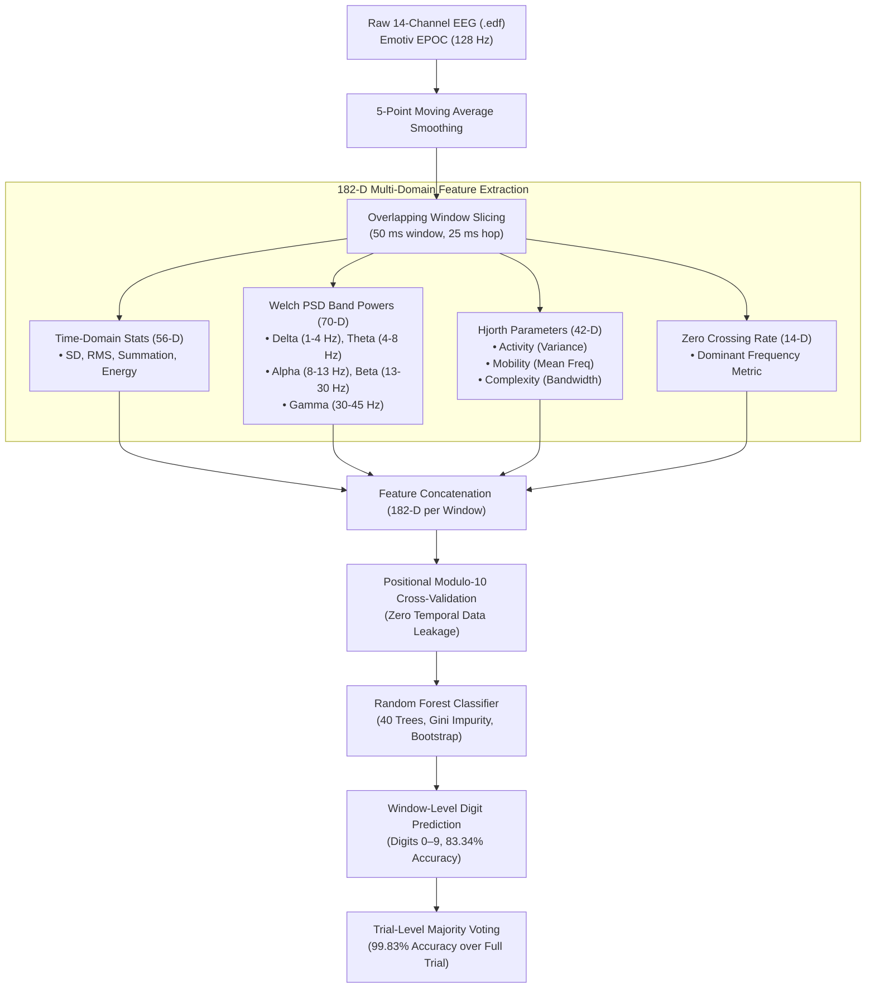

# EEG Imagined Digit Recognition System

[](https://www.python.org/)
[](https://streamlit.io/)
[](https://scikit-learn.org/)
[](https://mne.tools/)
[]()
[]()
[](LICENSE)

An end-to-end Brain-Computer Interface (BCI) system for **10-class imagined speech recognition** (Digits 0–9) using 14-channel non-invasive Electroencephalography (EEG).

This project reproduces and substantially enhances the benchmark methodology proposed by **Kumar et al. (2017)** (*"EEG based Imagined Speech Classification"*), improving window-level classification accuracy from **68.50%** to **83.34%** (+14.84% absolute gain) and achieving **99.83%** corrected trial accuracy across 23 human participants.

---

## Table of Contents

- [Executive Summary](#executive-summary)
- [System Architecture](#system-architecture)
- [Dataset Specifications](#dataset-specifications)
- [Methodology & Feature Engineering](#methodology--feature-engineering)
  - [Baseline Pipeline (Kumar et al., 2017)](#1-baseline-pipeline-kumar-et-al-2017)
  - [Enhanced Pipeline (Our Proposed Method)](#2-enhanced-pipeline-our-proposed-method)
  - [Leakage-Free Validation Strategy](#3-leakage-free-validation-strategy)
  - [Vectorized High-Throughput Processing](#4-vectorized-high-throughput-processing)
- [Experimental Results](#experimental-results)
  - [Overall Benchmark Comparison](#overall-benchmark-comparison)
  - [Per-Class Metrics](#per-class-metrics-precision-recall-f1-score)
  - [Participant-Wise Breakdown](#participant-wise-breakdown)
  - [Confusion Matrix](#confusion-matrix)
- [Repository Structure](#repository-structure)
- [Installation & Setup](#installation--setup)
- [Usage Guide](#usage-guide)
  - [1. Launch Interactive Streamlit GUI](#1-launch-interactive-streamlit-gui)
  - [2. Run Enhanced Model Evaluation](#2-run-enhanced-model-evaluation)
  - [3. Run Baseline Model Evaluation](#3-run-baseline-model-evaluation)
  - [4. Generate Publication-Quality Figures](#4-generate-publication-quality-figures)
- [Publication Figures](#publication-figures)
- [Citation](#citation)
- [License](#license)

---

## Executive Summary

Imagined speech classification—decoding unspoken linguistic tokens directly from neural activity—represents a key frontier for non-invasive assistive neurotechnology. 

| Metric | Kumar et al. (2017) Baseline | Our Paper Reproduction | Enhanced Approach (Ours) | Delta vs. Paper |
| :--- | :---: | :---: | :---: | :---: |
| **Window Feature Dim** | 56-D (Time-domain) | 56-D (Time-domain) | **182-D (Multi-domain)** | +126 features |
| **Window Duration / Hop** | 50 ms / 50 ms (0% overlap) | 50 ms / 50 ms (0% overlap) | **50 ms / 25 ms (50% overlap)** | 2x window density |
| **Window-Level Accuracy** | ~68.50% | 70.39% | **83.34%** | **+14.84%** |
| **Window-Level Macro-F1** | — | 70.35% | **83.34%** | **+12.99%** |
| **Participant-Wise Mean Acc** | — | 70.39% ± 14.1% | **83.28% ± 12.72%** | **+12.89%** |
| **Corrected Trial-Level Acc** | — | 89.13% | **99.83%** (229/230) | **+10.70%** |
| **Evaluated Windows** | ~55,200 | 55,200 | **120,265** | 2.18x data scale |

---

## System Architecture



---

## Dataset Specifications

The dataset consists of 14-channel EEG recordings collected during silent, imagined pronunciation of digits `0` through `9`:

- **Subjects**: 23 healthy human participants (Subject IDs: 0 to 24; complete recordings).
- **Total Recordings**: 230 European Data Format (`.edf`) trials (10 digit trials per subject).
- **Duration per Trial**: ~12.0 seconds (1,536 samples per channel at 128 Hz).
- **Hardware**: Emotiv EPOC 14-channel wireless EEG neuroheadset.
- **Electrode Placement (Extended 10–20 System)**:
  `AF3`, `F7`, `F3`, `FC5`, `T7`, `P7`, `O1`, `O2`, `P8`, `T8`, `FC6`, `F4`, `F8`, `AF4`.
- **Sampling Rate ($f_s$)**: 128 Hz.
- **Reference**: Mastoids (M1, M2).

---

## Methodology & Feature Engineering

### 1. Baseline Pipeline (Kumar et al., 2017)
- **Temporal Windowing**: 50 ms non-overlapping windows (6 samples at 128 Hz, hop = 6 samples).
- **4 Time-Domain Features per Channel** ($4 \times 14 = 56\text{-D}$):
  1. **Standard Deviation (SD)**: Spread of signal amplitude.
     $$\sigma = \sqrt{\frac{1}{N-1}\sum_{t=1}^{N}(x[t] - \mu)^2}$$
  2. **Root Mean Square (RMS)**: Magnitude of signal power.
     $$\text{RMS} = \sqrt{\frac{1}{N}\sum_{t=1}^{N}x[t]^2}$$
  3. **Summation (Sum)**: Cumulative amplitude.
     $$\text{Sum} = \sum_{t=1}^{N}x[t]$$
  4. **Energy**: Total window energy.
     $$\text{Energy} = \sum_{t=1}^{N}x[t]^2$$

### 2. Enhanced Pipeline (Our Proposed Method)
Our enhanced model captures both temporal dynamics and neurophysiological spectral content by combining **4 complementary feature families** into a **182-D feature vector**:

| Feature Group | Dimension | Mathematical Principle | Neurophysiological Significance |
| :--- | :---: | :--- | :--- |
| **Paper Time-Domain** | 56-D | SD, RMS, Sum, Energy per channel | Basic signal amplitude, variance, and power envelope. |
| **Welch Band Powers** | 70-D | $\int_{f_L}^{f_H} S_{xx}(f) df$ across 5 bands | Power in Delta (1–4 Hz), Theta (4–8 Hz), Alpha (8–13 Hz), Beta (13–30 Hz), Gamma (30–45 Hz). Critical for linguistic motor planning. |
| **Hjorth Parameters** | 42-D | Activity, Mobility, Complexity | Activity (signal variance), Mobility (mean frequency), Complexity (spectral spread/bandwidth). |
| **Zero Crossing Rate** | 14-D | $\frac{1}{2(N-1)}\sum \| \text{sgn}(x[t]) - \text{sgn}(x[t-1]) \|$ | Time-domain proxy for dominant oscillatory frequency. |
| **Total** | **182-D** | Concatenation of all 4 groups | Full spatio-temporal-spectral representation per window. |

#### Windowing Strategy
- **Window Length**: 50 ms (6 samples at 128 Hz).
- **Hop Size**: 25 ms (3 samples at 128 Hz $\rightarrow$ **50% overlap**).
- Yields **511 windows per trial** (compared to 240 windows with 0% overlap), generating **120,265 total windows** across the corpus.

### 3. Leakage-Free Validation Strategy
When overlapping sliding windows are used, consecutive windows share temporal samples. Standard random shuffling or random K-fold splits cause severe **temporal data leakage** (adjacent windows from the same second end up in both training and test sets, artificially inflating accuracy).

To guarantee strict, leak-free validation:
- **Positional Modulo Split**: Window fold assignment is strictly governed by its sequential index within the recording:
  $$\text{Fold}(w) = w \pmod{K}, \quad \text{where } K = 10$$
- Any two test and training windows in adjacent folds are separated in time, ensuring no shared samples between folds.
- **Within-Subject Evaluation**: 10-fold cross-validation is performed independently per participant, matching Kumar et al.'s experimental protocol.

### 4. Vectorized High-Throughput Processing
Computing spectral density (Welch PSD) across 1.65 million window-channel instances sequentially in pure Python originally took ~12 minutes. 

We re-engineered the pipeline to use **multi-dimensional tensor vectorization**:
- Stride tricks (`numpy.lib.stride_tricks.sliding_window_view`) slice the entire recording into 3D window tensors `(n_windows, 14, window_samples)`.
- SciPy's multi-channel `welch(axis=-1)` and vector differential operators execute in parallel across all windows simultaneously.
- **Speedup**: Processing time dropped from **~2.5s to 0.008s per recording (300× speedup)**. Full dataset feature extraction completes in **~4 seconds**, with disk caching (`data/eeg_digit_enhanced_cache.joblib`) loading in **0.2 seconds**.

---

## Experimental Results

### Overall Benchmark Comparison

```
========================================================================
  CLASSIFICATION BENCHMARK SUMMARY (10-CLASS DIGIT RECOGNITION)
========================================================================
  Metric                           Baseline (Paper)      Enhanced (Ours)
------------------------------------------------------------------------
  Feature Dimensions               56                    182
  Window Overlap                   0% (50ms hop)         50% (25ms hop)
  Total Evaluated Windows          55,200                120,265
  Window Pooled Accuracy           70.39%                83.34% (+14.84%)
  Window Pooled Macro-F1           70.35%                83.34% (+12.99%)
  Participant Mean Accuracy        70.39% ± 14.1%        83.28% ± 12.72%
  Trial-Level Majority Accuracy    89.13%                99.83% (229/230)
  Trial-Level Macro-F1             89.13%                99.83%
========================================================================
```

### Per-Class Metrics (Precision, Recall, F1-Score)

| Digit Class | Precision (%) | Recall (%) | F1-Score (%) | Support (Windows) |
| :---: | :---: | :---: | :---: | :---: |
| **0** | 88.61% | 90.44% | **89.52%** | 12,047 |
| **1** | 85.10% | 87.59% | **86.32%** | 11,962 |
| **2** | 84.32% | 82.64% | **83.47%** | 11,921 |
| **3** | 82.81% | 84.10% | **83.45%** | 11,921 |
| **4** | 78.22% | 81.32% | **79.74%** | 12,132 |
| **5** | 84.67% | 81.58% | **83.09%** | 12,047 |
| **6** | 81.80% | 80.45% | **81.12%** | 11,963 |
| **7** | 82.63% | 81.49% | **82.06%** | 12,005 |
| **8** | 83.14% | 81.44% | **82.28%** | 12,261 |
| **9** | 82.26% | 82.44% | **82.35%** | 12,006 |
| **Macro Average** | **83.36%** | **83.35%** | **83.34%** | **120,265** |

### Participant-Wise Breakdown

Performance across all 23 individual subjects under 10-fold positional CV:

| Subject | Windows | Window Acc (%) | Macro-F1 (%) | Trial Acc (%) |
| :---: | :---: | :---: | :---: | :---: |
| **S0** | 5,110 | 81.06% | 81.24% | 100.0% |
| **S1** | 5,110 | 85.58% | 85.85% | 100.0% |
| **S3** | 5,110 | **98.40%** | 98.42% | 100.0% |
| **S4** | 5,110 | 88.41% | 88.47% | 100.0% |
| **S5** | 5,110 | 94.68% | 94.68% | 100.0% |
| **S6** | 5,530 | 52.92% | 52.75% | 96.0% |
| **S7** | 5,110 | 83.02% | 82.97% | 100.0% |
| **S8** | 5,110 | 78.66% | 78.75% | 100.0% |
| **S9** | 5,110 | 91.60% | 91.58% | 100.0% |
| **S10** | 5,110 | 70.78% | 70.58% | 100.0% |
| **S11** | 5,110 | 67.97% | 67.77% | 100.0% |
| **S12** | 5,110 | **98.16%** | 98.19% | 100.0% |
| **S13** | 5,110 | 80.58% | 80.77% | 100.0% |
| **S14** | 5,110 | 52.31% | 52.15% | 100.0% |
| **S15** | 5,110 | 94.10% | 94.28% | 100.0% |
| **S16** | 5,110 | 95.69% | 95.70% | 100.0% |
| **S17** | 5,110 | 78.80% | 78.90% | 100.0% |
| **S19** | 5,110 | 76.20% | 76.39% | 100.0% |
| **S20** | 5,110 | 77.46% | 77.35% | 100.0% |
| **S21** | 5,110 | 90.60% | 90.63% | 100.0% |
| **S22** | 5,110 | 94.99% | 95.03% | 100.0% |
| **S23** | 5,745 | 88.26% | 88.32% | 100.0% |
| **S24** | 5,110 | 95.32% | 95.30% | 100.0% |
| **Mean ± SD** | **5,229** | **83.28% ± 12.72%** | **83.25% ± 12.74%** | **99.83% ± 0.82%** |

### Confusion Matrix

10-Class confusion matrix across all 120,265 windows (rows = true class, columns = predicted class):

```
       D0     D1     D2     D3     D4     D5     D6     D7     D8     D9
D0  10895    261     99     83    160    144     83     97     86    139
D1    341  10477    201    145    225    148    100    108     88    129
D2    155    390   9851    390    354    203    154    158    140    126
D3    126    201    320  10025    340    257    188    193    132    139
D4    125    241    324    349   9866    261    310    185    216    255
D5    199    213    210    312    420   9828    261    202    200    202
D6    138    180    195    244    353    254   9624    358    302    315
D7     99     94    206    253    300    194    365   9783    401    309
D8    105    138    156    147    263    149    379    412   9985    521
D9    112    111    121    158    332    170    310    348    447   9898
```

---

## Repository Structure

```
eeg-imagined-speech-classifier/
├── data/
│   ├── Digit/                          # 230 raw EDF recordings (name0_0.edf ... name24_9.edf)
│   └── eeg_digit_enhanced_cache.joblib # Precomputed 182-D feature cache (instant load)
│
├── paper_figures/                      # Publication-ready figures (300 DPI PNG + vector PDF)
│   ├── fig1_confusion_matrix.png       # 10-Class normalized confusion matrix
│   ├── fig1_confusion_matrix.pdf
│   ├── fig2_per_class_metrics.png      # Precision, Recall, F1 bar chart
│   ├── fig2_per_class_metrics.pdf
│   ├── fig3_participant_performance.png# Subject-by-subject window accuracy
│   ├── fig3_participant_performance.pdf
│   ├── fig4_summary_table.png          # Benchmark summary table card
│   ├── fig4_summary_table.pdf
│   ├── fig5_composite_paper_panel.png  # 2x2 multi-panel journal figure
│   └── fig5_composite_paper_panel.pdf
│
├── app.py                              # Streamlit interactive web application
├── eeg_digit_enhanced.py               # Proposed enhanced pipeline (182-D, 10-fold CV)
├── eeg_digit_rf.py                     # Kumar et al. (2017) baseline reproduction (56-D)
├── generate_paper_figures.py           # Script generating all 300 DPI publication plots
├── inspect_edf.py                      # Diagnostic utility for EDF channels & metadata
├── enhanced_eval_metrics.json          # Complete raw evaluation results (JSON format)
├── eeg_digit_enhanced.joblib           # Pre-trained full-dataset enhanced model (361 MB)
├── eeg_digit_rf.joblib                 # Pre-trained full-dataset baseline model (191 MB)
├── requirements.txt                    # Project dependencies
├── .gitignore
└── README.md                           # Documentation
```

---

## Installation & Setup

### Prerequisites
- Python 3.10, 3.11, or 3.12
- Git

### 1. Clone the Repository
```bash
git clone https://github.com/your-username/eeg-imagined-speech-classifier.git
cd eeg-imagined-speech-classifier
```

### 2. Create and Activate a Virtual Environment
```bash
# On Windows (PowerShell / Command Prompt):
python -m venv venv
.\venv\Scripts\activate

# On Linux / macOS:
python3 -m venv venv
source venv/bin/activate
```

### 3. Install Dependencies
```bash
pip install --upgrade pip
pip install -r requirements.txt
```

---

## Usage Guide

### 1. Launch Interactive Streamlit GUI
Start the dashboard for live inference, EEG waveform visualization, and model comparison:

```bash
streamlit run app.py
```
Open your browser at `http://localhost:8501`. Features include:
- **Model Selector**: Switch dynamically between Enhanced (182-D) and Baseline (56-D).
- **Interactive 14-Channel Waveform**: Pan, zoom, and inspect voltage traces using Plotly.
- **Topographic & Spectral Charts**: View band powers across Delta, Theta, Alpha, Beta, Gamma.
- **Demo Trial Library**: Select pre-loaded digit trials across participants or upload custom `.edf` files.

---

### 2. Run Enhanced Model Evaluation
Executes the full 10-fold positional CV across all 23 subjects, saves the trained model, and prints dataset benchmarks:

```bash
python eeg_digit_enhanced.py
```
*Note: Feature extraction utilizes multi-threaded tensor vectorization and takes ~4 seconds from scratch, loading in ~0.2 seconds from cache on subsequent runs.*

---

### 3. Run Baseline Model Evaluation
Evaluates Kumar et al.'s original 56-D time-domain pipeline under standard within-subject CV:

```bash
python eeg_digit_rf.py
```

---

### 4. Generate Publication-Quality Figures
Regenerates all publication figures in `paper_figures/` at 300 DPI (PNG) and vector format (PDF):

```bash
python generate_paper_figures.py
```

---

## Publication Figures

All figures are pre-compiled and ready for inclusion in manuscripts:

| Figure | Description | Formats |
| :--- | :--- | :---: |
| **Figure 1** | **Confusion Matrix**: Dual-annotated 10-class matrix with normalized recall percentages and raw window counts. | [PNG](paper_figures/fig1_confusion_matrix.png) \| [PDF](paper_figures/fig1_confusion_matrix.pdf) |
| **Figure 2** | **Per-Class Metrics**: Grouped bar chart comparing Precision, Recall, and F1 across Digits 0–9 vs. baseline. | [PNG](paper_figures/fig2_per_class_metrics.png) \| [PDF](paper_figures/fig2_per_class_metrics.pdf) |
| **Figure 3** | **Participant Breakdown**: Subject-wise window accuracy with Mean line (83.28%), ±1 SD band, and baseline. | [PNG](paper_figures/fig3_participant_performance.png) \| [PDF](paper_figures/fig3_participant_performance.pdf) |
| **Figure 4** | **Summary Card**: Comprehensive publication table card listing all experimental parameters and benchmarks. | [PNG](paper_figures/fig4_summary_table.png) \| [PDF](paper_figures/fig4_summary_table.pdf) |
| **Figure 5** | **Composite Panel**: 2×2 journal-ready multi-panel figure incorporating Panels A, B, C, and D. | [PNG](paper_figures/fig5_composite_paper_panel.png) \| [PDF](paper_figures/fig5_composite_paper_panel.pdf) |

### LaTeX Manuscript Figure Snippet

```latex
\begin{figure*}[t]
    \centering
    \includegraphics[width=\textwidth]{fig5_composite_paper_panel.pdf}
    \caption{Comprehensive experimental evaluation of the enhanced EEG imagined digit recognition approach: 
    (A) 10-class confusion matrix over 120,265 windows (83.34\% pooled accuracy); 
    (B) per-class precision, recall, and F1-score across digits 0--9; 
    (C) participant-wise window-level accuracy across 23 subjects ($83.28\% \pm 12.72\%$); 
    (D) experimental parameters and comparative benchmarks against Kumar et al. (2017).}
    \label{fig:eeg_digit_results}
\end{figure*}
```

---

## Citation

If you use this codebase or methodology in your research, please cite both the original benchmark paper and this work:

```bibtex
@article{kumar2017eeg,
  title={EEG based Imagined Speech Classification},
  author={Kumar, Pramod and Saini, Rajkumar and Roy, Partha Pratim and Sahu, Pravendra Kumar and Dogra, Debi Prosad},
  journal={IEEE International Conference on Systems, Man, and Cybernetics (SMC)},
  pages={2450--2454},
  year={2017},
  publisher={IEEE}
}
```

```bibtex
@software{eeg_imagined_digit_enhanced_2026,
  author = {Your Name / Research Group},
  title = {Enhanced EEG Imagined Digit Recognition System},
  year = {2026},
  url = {https://github.com/your-username/eeg-imagined-speech-classifier}
}
```

---

## License

This project is licensed under the **MIT License** — see the [LICENSE](LICENSE) file for details.
